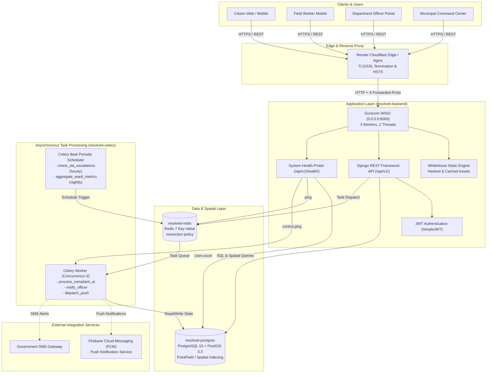

# JANMITRA — Nagpur Municipal Corporation (NMC)
## Civic Issue Reporting & Municipal Redressal Platform

[](https://www.djangoproject.com/)
[](https://www.django-rest-framework.org/)
[](https://www.postgresql.org/)
[](https://postgis.net/)
[](https://docs.celeryq.dev/)
[](https://redis.io/)
[](https://react.dev/)
[](https://tailwindcss.com/)
[](https://render.com/)

**JANMITRA** ("Friend of the Citizen") is an enterprise civic grievance redressal and municipal operations management system built for the **Nagpur Municipal Corporation (NMC)**. Developed by **Team ResolveIT**, JANMITRA modernizes the civic complaints lifecycle through geo-spatial tracking (PostGIS), automated departmental task routing, SLA escalation tracking, field worker verification, and city command-center analytics.

---

## Table of Contents
1. [Project Overview](#1-project-overview)
2. [Key Features & Implementation Status](#2-key-features--implementation-status)
3. [Technology Stack](#3-technology-stack)
4. [System Architecture](#4-system-architecture)
5. [Quickstart — Local Development](#5-quickstart--local-development)
6. [Cloud Deployment (Render Blueprint)](#6-cloud-deployment-render-blueprint)
7. [API Reference](#7-api-reference)
8. [Testing & Quality Assurance](#8-testing--quality-assurance)
9. [HTTP Security & Privacy Standards](#9-http-security--privacy-standards)
10. [Team ResolveIT Credits](#10-team-resolveit-credits)
11. [Project Status & License](#11-project-status--license)

---

## 1. Project Overview

### The Municipal Problem in Nagpur
Municipal corporations encounter critical operational challenges managing civic complaints:
- Citizens lack transparent, real-time tracking for everyday issues like potholes, open garbage dumps, water main bursts, and broken streetlights.
- Grievances are submitted without precise GPS coordinates, leading to misallocated field workers and delayed resolutions.
- Municipal officers lack automated SLA monitoring, resulting in overlooked tickets and delayed escalations.
- Field resolutions often lack verifiable proof, creating citizen dissatisfaction and duplicate reporting.

### The JANMITRA Solution
JANMITRA bridges the gap between citizens, municipal field workers, department officers, and executive city commissioners through an end-to-end digital lifecycle:
1. **Reporting:** Citizens submit geo-tagged complaints with photographic evidence and automatic ward detection.
2. **AI & Spatial Triage:** Complaints are evaluated for fraud probability, duplicate clustering, and automated department routing.
3. **Field Dispatch:** Department officers assign tickets to verified on-duty field workers based on ward and department specialization.
4. **Resolution Proof:** Workers upload geo-tagged resolution photos and status updates (`In Progress` &rarr; `Resolved`).
5. **Citizen Verification & Feedback:** Citizens verify the fix; if unsatisfactory, the issue can be rejected and reopened without resetting the SLA breach clock.
6. **Command Center:** NMC administrators monitor real-time ward-level KPIs, SLA compliance rates, and overdue ticket ledgers.

---

## 2. Key Features & Implementation Status

To ensure complete transparency, all features are classified according to their actual implementation status in the codebase:

| Feature Area | Description | Implementation Status | Code Location / Details |
| :--- | :--- | :---: | :--- |
| **4 Canonical Categories** | Fixed municipal domains: `Roads & Infrastructure` (PWD), `Garbage & Waste` (SWM), `Water & Drainage` (PHE), and `Street Lighting` (ELEC). | **Implemented** | [complaints/models.py](file:///c:/Users/Anas/OneDrive/Desktop/JANMITRA/backend/complaints/models.py), [complaints/migrations/0003_complaint_system.py](file:///c:/Users/Anas/OneDrive/Desktop/JANMITRA/backend/complaints/migrations/0003_complaint_system.py) |
| **4 Municipal Wards** | Initial Nagpur zones configured with polygon models: `Ward 1` (Laxmi Nagar), `Ward 2` (Dharampeth), `Ward 3` (Hanuman Nagar), `Ward 4` (Dhantoli). | **Implemented** | [complaints/models.py](file:///c:/Users/Anas/OneDrive/Desktop/JANMITRA/backend/complaints/models.py), seeded via `seed_demo_accounts` |
| **PostGIS Spatial Engine** | GeoDjango `PointField(geography=True, srid=4326)` for GPS location logging, spatial indexing, and GeoJSON export. | **Implemented** | [complaints/models.py](file:///c:/Users/Anas/OneDrive/Desktop/JANMITRA/backend/complaints/models.py#L205), [complaints/views.py](file:///c:/Users/Anas/OneDrive/Desktop/JANMITRA/backend/complaints/views.py#L250) |
| **100m Proximity & Clustering** | Spatial schema and data fields (`is_duplicate`, `parent_complaint`) for 100-metre duplicate clustering. | **Partially Implemented** | Database schema and task pipeline hooks implemented; automated spatial distance clustering query planned for external GIS microservice. |
| **AI Validation Pipeline** | Celery task pipeline (`process_complaint_ai`) for fraud scoring, image validation, priority assignment, and officer review gating. | **Implemented** | [complaints/tasks.py](file:///c:/Users/Anas/OneDrive/Desktop/JANMITRA/backend/complaints/tasks.py#L126-L190); pluggable hook `analyze_complaint_ai` connects to vision/LLM models. |
| **FCM Push Notifications** | Device token storage (`fcm_device_token`), registration endpoint (`PATCH /api/v1/auth/fcm-token/`), and Celery dispatch task. | **Partially Implemented** | Backend model, endpoint, and Celery dispatch task implemented; direct external Firebase SDK delivery requires live Firebase service account key. |
| **In-App Notifications** | Role-based notifications for citizens, workers, officers, and admins with read tracking and unread counters. | **Implemented** | [notifications/models.py](file:///c:/Users/Anas/OneDrive/Desktop/JANMITRA/backend/notifications/models.py), [notifications/views.py](file:///c:/Users/Anas/OneDrive/Desktop/JANMITRA/backend/notifications/views.py) |
| **Role-Based Access Control** | 4 distinct roles: `Citizen`, `Field Worker`, `Department Officer`, and `Admin`. Custom DRF permission classes. | **Implemented** | [accounts/permissions.py](file:///c:/Users/Anas/OneDrive/Desktop/JANMITRA/backend/accounts/permissions.py), [accounts/models.py](file:///c:/Users/Anas/OneDrive/Desktop/JANMITRA/backend/accounts/models.py) |
| **SLA Tracking & Breach Alerts** | Strict SLA targets: Critical (24h), High (48h), Medium (72h), Low (168h). Non-resetting clock policy on reopen. | **Implemented** | [complaints/services.py](file:///c:/Users/Anas/OneDrive/Desktop/JANMITRA/backend/complaints/services.py), Celery Beat periodic task `check_sla_escalations` |
| **Citizen Resolution Verification** | Citizens review photographic proof of work, accept the fix, or reject and reopen the grievance. | **Implemented** | [complaints/views.py](file:///c:/Users/Anas/OneDrive/Desktop/JANMITRA/backend/complaints/views.py#L700-L800) |
| **Command Center Analytics** | Real-time dashboards for city-wide KPIs, ward statistics, submission trends, worker workloads, and high-priority ledgers. | **Implemented** | [dashboard/views.py](file:///c:/Users/Anas/OneDrive/Desktop/JANMITRA/backend/dashboard/views.py) |
| **System Health Check API** | Production-safe health probe inspecting Database, Redis, and Celery independently with bounded timeouts. | **Implemented** | [accounts/views.py](file:///c:/Users/Anas/OneDrive/Desktop/JANMITRA/backend/accounts/views.py#L480), `/api/v1/health/` |

---

## 3. Technology Stack

### Backend
- **Language / Runtime:** Python `3.11`
- **Web Framework:** Django `4.2 LTS`
- **API Framework:** Django REST Framework `3.14.0+`
- **Geospatial Processing:** GeoDjango with `django.contrib.gis` and `djangorestframework-gis`
- **Authentication:** `djangorestframework-simplejwt 5.3.1` (HMAC-SHA256 JWT tokens)
- **WSGI Production Server:** Gunicorn `21.2.0` (Configured for 3 workers, 2 threads)
- **Static Assets:** WhiteNoise `6.5.0` (`CompressedManifestStaticFilesStorage`)

### Database & Message Broker
- **Primary Database:** PostgreSQL `15` with PostGIS `3.3` spatial extension
- **Database Connection Pooling:** `dj-database-url 2.1.0` (`conn_max_age=600`, dynamic SSL handling)
- **Message Broker & Cache:** Redis `7` (Alpine / Render Key-Value Store)
- **Asynchronous Processing:** Celery `5.3.6` (Worker with concurrency 2)
- **Task Scheduler:** `django-celery-beat 2.5.0` (Database-backed periodic scheduler)
- **Task Results:** `django-celery-results 2.5.1`

### Frontend
- **Library / Runtime:** React `18.2.0`, Node `18+`
- **Build Tool:** Vite `5.2.8`
- **Styling:** Tailwind CSS `3.4.3` with Autoprefixer and PostCSS
- **Iconography:** Lucide React `0.363.0`
- **HTTP Client:** Axios `1.6.8`

---

## 4. System Architecture

The following flowchart illustrates the system components, network boundaries, and data flow across the JANMITRA platform:



---

## 5. Quickstart — Local Development

### Prerequisites
- **Docker & Docker Compose** (Docker Desktop recommended)
- **Python 3.11+** (if running natively without Docker)
- **Node.js 18+ & npm** (if running frontend natively)
- **Git**

---

### Approach 1: Full Docker Compose Environment (Recommended)

This launches all 6 services (`postgres` with PostGIS, `redis`, `backend`, `celery`, `celery-beat`, `frontend`) in isolated bridge network containers:

```bash
# 1. Clone the repository
git clone https://github.com/YourOrg/JANMITRA.git
cd JANMITRA

# 2. Set up environment configuration
cp .env.example .env

# 3. Build and launch all containers
docker compose up --build
```

#### Apply Migrations & Seed Demo Accounts (In a new terminal):
```bash
# Apply database schema
docker compose exec backend python manage.py migrate --noinput

# Seed 4 departments, 4 wards, 4 categories, and 25 test users
docker compose exec backend python manage.py seed_demo_accounts
```

#### Access Points:
- **Frontend Web UI:** `http://localhost:5173`
- **Backend REST API:** `http://localhost:8000/api/v1/`
- **System Health Check:** `http://localhost:8000/api/v1/health/`
- **Django Admin Console:** `http://localhost:8000/admin/`

---

### Approach 2: Native Local Development (Virtualenv)

If developing backend and frontend natively:

#### 1. Backend Setup
```bash
# Navigate to project root
cd JANMITRA

# Create and activate Python virtual environment
python -m venv .venv
# On Windows:
.venv\Scripts\activate
# On Linux / macOS:
source .venv/bin/activate

# Install dependencies
pip install -r backend/requirements.txt

# Run migrations (uses SQLite in-memory fallback if PostgreSQL is not running)
python backend/manage.py migrate --noinput

# Seed demo data
python backend/manage.py seed_demo_accounts

# Start Django development server
python backend/manage.py runserver 0.0.0.0:8000
```

#### 2. Frontend Setup (In a separate terminal)
```bash
cd JANMITRA/frontend
npm install
npm run dev
```

---

### Seeded Demo Accounts Reference

When `python manage.py seed_demo_accounts` is run, the following accounts are initialized with password **`Demo@12345`**:

| Role | Username / Identifier | Name / Function | Ward / Specialization |
| :--- | :--- | :--- | :--- |
| **Central Admin** | `admin@janmitra.gov.in` | Janmitra Admin | City-wide NMC Superuser (`is_superuser=True`) |
| **Dept Officer** | `9800000001` | Rajesh Kumar | PWD Executive Engineer |
| **Dept Officer** | `9800000002` | Sunita Deshmukh | SWM Sanitation Chief Inspector |
| **Dept Officer** | `9800000003` | Amitabh Joshi | PHE Water Works Chief Engineer |
| **Dept Officer** | `9800000004` | Pooja Sharma | Electrical Superintending Engineer |
| **Field Worker** | `9810010001` | Worker PWD Ward 1 | Road Maintenance (Ward 1) |
| **Field Worker** | `9810020002` | Worker SWM Ward 2 | Sanitation Crew (Ward 2) |
| **Citizen** | `9820000001` | Aarav Mehta | Citizen Resident (Ward 1) |
| **Citizen** | `9820000002` | Sneha Nair | Citizen Resident (Ward 2) |

---

## 6. Cloud Deployment (Render Blueprint)

JANMITRA is configured for cloud deployment using [render.yaml](file:///c:/Users/Anas/OneDrive/Desktop/JANMITRA/render.yaml) (Render Blueprints Infrastructure as Code).

### Configured Services:
1. **`resolveit-backend` (Web Service):**
   - **Runtime:** Python 3.11 (`starter` plan)
   - **Start Command:** `gunicorn resolveIT.wsgi:application --bind 0.0.0.0:$PORT --workers 3 --threads 2`
   - **Port:** Internal port `8000` (`$PORT` dynamically assigned by Render)
   - **Health Check Path:** `/api/v1/health/`
   - **Pre-Deploy Hook:** `python manage.py migrate --noinput` (Zero-downtime database updates)
2. **`resolveit-celery` (Background Worker):**
   - **Runtime:** Python 3.11 (`starter` plan)
   - **Start Command:** `celery -A resolveIT worker -l info --concurrency=2`
   - Reuses `DATABASE_URL` and `REDIS_URL` from the backend configuration.
3. **`resolveit-postgres` (Managed Database):**
   - **Engine:** PostgreSQL 15 (`starter` plan required for PostGIS)
   - **Security:** Private network only (`ipAllowList: []`)
4. **`resolveit-redis` (Key-Value Store):**
   - **Plan:** `starter`
   - **Eviction Policy:** `maxmemoryPolicy: noeviction` (Protects queued citizen tasks)

### Cloud Deployment Prerequisites & Limitations:
- **PostGIS Extension Initialization:** Render PostgreSQL does not enable PostGIS automatically. After database provisioning, execute in `psql`:
  ```sql
  CREATE EXTENSION IF NOT EXISTS postgis;
  ```
- **PostGIS Plan Limitation:** PostGIS is **only supported on Render Starter plan ($7/mo) or higher**. It is **not supported on the Render Free Tier**.
- **GeoDjango Runtime Libraries:** If Render's native Python runtime encounters missing C-libraries (`libgdal`, `libgeos`), deploy via Docker runtime (`runtime: image` / `docker`) using the provided [backend/Dockerfile](file:///c:/Users/Anas/OneDrive/Desktop/JANMITRA/backend/Dockerfile).
- For complete operational guidance, refer to the [RENDER_DEPLOYMENT_GUIDE.md](file:///c:/Users/Anas/OneDrive/Desktop/JANMITRA/RENDER_DEPLOYMENT_GUIDE.md).

---

## 7. API Reference

Comprehensive interactive API documentation is available in [API_DOCUMENTATION.md](file:///c:/Users/Anas/OneDrive/Desktop/JANMITRA/API_DOCUMENTATION.md) and [JANMITRA_Postman_Collection.json](file:///c:/Users/Anas/OneDrive/Desktop/JANMITRA/JANMITRA_Postman_Collection.json) (with [JANMITRA_Postman_Environment.json](file:///c:/Users/Anas/OneDrive/Desktop/JANMITRA/JANMITRA_Postman_Environment.json)).

### Core Endpoints Summary

| HTTP Method | Route | Description / Purpose | Authentication |
| :--- | :--- | :--- | :--- |
| `GET` | `/api/v1/health/` | System Health Check (Database, Redis, Celery) | Public (`AllowAny`) |
| `GET` | `/api/health/` | Legacy Health Check Route (Backward-compatible alias) | Public (`AllowAny`) |
| `POST` | `/api/v1/auth/register/` | Citizen self-registration with Ward assignment | Public (`AllowAny`) |
| `POST` | `/api/v1/auth/login/` | User authentication returning JWT access & refresh tokens | Public (`AllowAny`) |
| `POST` | `/api/v1/auth/refresh/` | JWT token rotation | Public (`AllowAny`) |
| `PATCH` | `/api/v1/auth/fcm-token/` | Update Firebase Cloud Messaging device push token | Authenticated (JWT) |
| `GET` / `PUT` | `/api/v1/auth/profile/` | Retrieve or update user profile | Authenticated (JWT) |
| `GET` | `/api/v1/meta/categories/` | Public list of municipal categories and mapped departments | Public (`AllowAny`) |
| `GET` | `/api/v1/meta/wards/` | Public list of configured municipal wards | Public (`AllowAny`) |
| `GET` | `/api/v1/complaints/` | Filtered list of complaints (Ward, status, department) | Authenticated (JWT) |
| `POST` | `/api/v1/complaints/` | Submit new civic complaint with GPS coordinates & photo | Authenticated (Citizen/Staff) |
| `GET` | `/api/v1/complaints/<id>/` | Detailed complaint data with timeline and worker assignment | Authenticated (JWT) |
| `PATCH` | `/api/v1/complaints/<id>/status/` | Update complaint status (`Assigned`, `In Progress`, etc.) | Officer / Worker |
| `POST` | `/api/v1/complaints/<id>/assign/` | Assign field worker to a complaint | Dept Officer / Admin |
| `POST` | `/api/v1/complaints/<id>/proof-upload/`| Upload photo proof of work upon resolution | Assigned Worker |
| `POST` | `/api/v1/complaints/<id>/verify/` | Citizen accepts resolution or rejects & reopens | Complaint Owner |
| `GET` | `/api/v1/complaints/<id>/timeline/`| Chronological audit trail of all status transitions | Authenticated (JWT) |
| `GET` | `/api/v1/complaints/nearby/` | Spatial query returning complaints within a radius | Authenticated (JWT) |
| `GET` | `/api/v1/complaints/geojson/` | GeoJSON FeatureCollection for mapping integration | Authenticated (JWT) |
| `GET` | `/api/v1/worker/available/` | Available field workers matching complaint department & ward | Dept Officer / Admin |
| `GET` | `/api/v1/worker/tasks/` | List grievances assigned to the calling field worker | Field Worker |
| `PATCH` | `/api/v1/worker/tasks/<id>/status/`| Update status from field worker app | Field Worker |
| `POST` | `/api/v1/worker/tasks/<id>/proof/` | Worker uploads photo proof of work | Field Worker |
| `GET` | `/api/v1/dashboard/kpi/` | Executive KPIs (Total, Pending, Resolved, Breached, SLA %) | Dept Officer / Admin |
| `GET` | `/api/v1/dashboard/ward-stats/` | Ward-by-ward volume and resolution rate breakdown | Dept Officer / Admin |
| `GET` | `/api/v1/dashboard/trends/` | Daily ticket submission and resolution trends | Dept Officer / Admin |
| `GET` | `/api/v1/dashboard/workers/` | Field worker workload and active task counts | Dept Officer / Admin |
| `GET` | `/api/v1/dashboard/high-priority/` | Ledger of critical and overdue SLA-breached complaints | Dept Officer / Admin |
| `GET` | `/api/v1/dashboard/pending-validation/`| List of complaints flagged by AI for fraud review | Dept Officer / Admin |
| `PATCH` | `/api/v1/dashboard/complaints/<id>/validate/`| Officer manually validates or dismisses flagged issue | Dept Officer / Admin |
| `GET` / `POST` | `/api/v1/admin/workers/` | List all registered municipal field workers or create worker | Admin Only |
| `PATCH` | `/api/v1/admin/workers/<id>/`| Update worker department, ward, designation, or status | Admin / Dept Officer |
| `GET` / `PUT` | `/api/v1/admin/settings/` | Global SLA threshold hours and auto-routing switches | Admin Only |
| `GET` | `/api/v1/notifications/` | In-app alerts for logged-in user | Authenticated (JWT) |
| `POST` | `/api/v1/notifications/<id>/mark-read/`| Mark a single alert as read | Authenticated (JWT) |
| `POST` | `/api/v1/notifications/mark-all-read/` | Mark all alerts as read | Authenticated (JWT) |
| `GET` | `/api/v1/notifications/unread-count/` | Count of unread alerts for navigation badges | Authenticated (JWT) |

---

## 8. Testing & Quality Assurance

JANMITRA maintains a test suite covering models, serializers, views, RBAC permissions, Celery retries, database transaction recovery, and production security settings.

### Running Tests Locally
```bash
# Run full project test suite (404 tests)
python backend/manage.py test accounts complaints dashboard notifications --keepdb

# Run focused app test suites
python backend/manage.py test accounts --keepdb
python backend/manage.py test complaints --keepdb
python backend/manage.py test dashboard --keepdb
python backend/manage.py test notifications --keepdb

# Run focused security & health check tests
python backend/manage.py test accounts.tests.test_health_check --keepdb
python backend/manage.py test accounts.tests.test_production_security_settings --keepdb
```

### Django Production Deploy Checks
```bash
# Run Django system checks
python backend/manage.py check

# Run production deployment check
python backend/manage.py check --deploy --settings=resolveIT.settings.production
```

---

## 9. HTTP Security & Privacy Standards

JANMITRA enforces HTTP security standards in [production.py](file:///c:/Users/Anas/OneDrive/Desktop/JANMITRA/backend/resolveIT/settings/production.py):

- **Automatic HTTPS Redirection:** `SECURE_SSL_REDIRECT = True` redirects all unencrypted HTTP requests to HTTPS.
- **Strict Transport Security (HSTS):** `SECURE_HSTS_SECONDS = 31536000` (1 Year) with `SECURE_HSTS_INCLUDE_SUBDOMAINS = True`.
- **HSTS Preload Policy:** `SECURE_HSTS_PRELOAD = False` is intentionally deferred pending a formal domain-readiness review, preventing premature browser-level domain locking.
- **Reverse Proxy Header:** `SECURE_PROXY_SSL_HEADER = ('HTTP_X_FORWARDED_PROTO', 'https')` enables Cloudflare/Render edge TLS termination without redirect loops.
- **Cookie Encryption:** `SESSION_COOKIE_SECURE = True` and `CSRF_COOKIE_SECURE = True` prevent session tokens from being transmitted over plaintext connections.
- **Anti-Clickjacking & MIME Defense:** `X_FRAME_OPTIONS = 'DENY'` and `SECURE_CONTENT_TYPE_NOSNIFF = True` protect against UI redressing and MIME-confusion attacks.
- **Credential Protection:** Zero production secrets or API keys are committed to Git. The `.gitignore` excludes `.env`, `*.log`, `db.sqlite3`, and generated media. Refer to [SECURITY_SETTINGS_ADDITIONS.md](file:///c:/Users/Anas/OneDrive/Desktop/JANMITRA/SECURITY_SETTINGS_ADDITIONS.md) for the credential audit report.

---

## 10. Team ResolveIT Credits

JANMITRA is designed and developed by **Team ResolveIT** for the Nagpur Municipal Corporation civic modernization initiative:

| Role / Responsibility | Assigned Contributor | Status in Repository Metadata |
| :--- | :--- | :--- |
| **Project Lead & Backend Architecture** | *[Team Member - To be confirmed]* | Role confirmed in project structure; name pending formal attribution |
| **Full Stack & Frontend Engineering** | *[Team Member - To be confirmed]* | Role confirmed in UI implementation; name pending formal attribution |
| **Geospatial & Database Engineering** | *[Team Member - To be confirmed]* | Role confirmed in PostGIS schema; name pending formal attribution |
| **DevOps & Cloud Infrastructure** | *[Team Member - To be confirmed]* | Role confirmed in Render/Docker config; name pending formal attribution |

*(To update or claim formal contribution credits, submit a pull request updating this section with verified team member names and institutional email addresses).*

---

## 11. Project Status & License

### Project Status
- **Current Version:** `v1.0.0-rc1` (Release Candidate)
- **Environment:** Staging / Production Cloud Blueprint Ready
- **Operational Readiness:** Fully passing test suite (404/404 tests passing), PostGIS-enabled database migrations validated, WhiteNoise static pipeline configured, and Render Blueprint schema compliant.

### License Information
- **License:** **Not Specified**.  
  This software is developed specifically for the Nagpur Municipal Corporation (NMC). No public open-source license has been applied to this repository. All rights are reserved by Nagpur Municipal Corporation and Team ResolveIT unless otherwise agreed in writing.
